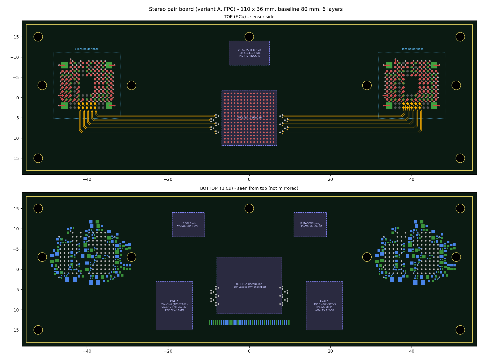

# 2. Stereo pair board (variant A) — build ×4

Generated files:

| File | Content |
|---|---|
| `hardware/kicad/stereo_board/stereo_board.kicad_pcb` / `.kicad_pro` | 6-layer layout demo |
| `hardware/kicad/stereo_board/layout_preview.png` | top/bottom render |
| `hardware/stereo_board/stereo_board_netlist.csv` | every IMX568 ball (L and R), all decoupling, glue and IC functions → net |
| `hardware/stereo_board/stereo_board_bom.csv` | grouped BOM per board |
| `hardware/stereo_board/imx568_pin_net_L.csv`, `_R.csv` | sensor ball → net |
| `fpga/stereo_ctrl.v` (+ testbench) | power sequencing / trigger / status logic |

Regenerate with `python3 hardware/tools/gen_kicad.py --baseline 80` (any baseline ≥ 50 mm) and `python3 hardware/tools/gen_netlist.py`.



## 2.1 Block diagram

```
 VIN_5V (FPC) ─► TPS62162 ─► +3V6 ─┬─ TLV62569 ─► +1V1_BUCK ─ TPS22918(EN_1V1) ─► +1V1 ─┬─ 10µH ─► +1V1_LIF_L / _R
                                   │                                                   └─ 10µH ─► +1V1_PLA_L / _R
                                   ├─ TLV62569 ─► +1V0_FPGA (core)
                                   ├─ TLV75518 ─► +1V8 (always on: FPGA VCCAUX/VCCIO, flash, osc, I2C side 1)
                                   │                └ TPS22918(EN_1V8S) ─► +1V8_SNS (VDDMIO ×2, LMK1C1102, I2C side 2)
                                   ├─ LDO 2.9 V ─► TPS22918(EN_2V9) ─► +2V9  (VDDH* ×2)
                                   └─ LP5912-3.3 ─► TPS22918(EN_3V3) ─► +3V3A (VDD33* ×2)

 Y1 74.25 MHz (1V8, always on) ─┬─► FPGA ref clock
                                └─► LMK1C1102 (OE = INCK_OE) ─► INCK_L, INCK_R (22 Ω series)

 FPC: PWR_EN, TRIG ─► FPGA stereo_ctrl ─► EN_1V1/1V8S/2V9/3V3, XCLR (both), INCK_OE, XTRIG_L, XTRIG_R, STATUS ─► FPC
 FPC: I2C ─► PCA9306 (enabled by +1V8_SNS) ─► IMX568 L (0x36) + IMX568 R (0x3D)
 IMX568 L CSI x4 ─► FPGA hard D-PHY RX ┐
 IMX568 R CSI x4 ─► FPGA soft D-PHY RX ┤ Lattice VC aggregation RD ─► hard D-PHY TX x4 ─► FPC
 TOUT0_L / TOUT0_R ─► FPC (exposure monitor)
```

## 2.2 Sensors (×2)

Each sensor is connected exactly as in the datasheet reference circuit (§19), with the same decoupling as the single-camera design. The full ball list is in `imx568_pin_net_L/R.csv`. Differences from a single camera:

| Signal | Left (U1) | Right (U2) |
|---|---|---|
| SLAMODE0/1/2 | 10 kΩ → GND → I²C **0x36** | 10 kΩ → +1V8_SNS → I²C **0x3D** |
| XMASTER | 0 Ω → GND (master, required for fast trigger) | same |
| XCLR | FPGA_XCLR via 10 Ω | same net, own 10 Ω |
| XTRIG1 | FPGA_XTRIG_L via 10 Ω | FPGA_XTRIG_R via 10 Ω. Match L/R trace lengths |
| INCK | INCK_L (LMK1C1102 Y0) via 22 Ω | INCK_R (Y1) |
| CSI-2 | FPGA hard D-PHY RX | FPGA soft D-PHY RX (HP bank) |
| VCP1/VCP2, VDDLIF/VDDLPLA filters | per sensor (L_/R_ nets) | per sensor |

Shared rails (+1V1, +1V8_SNS, +2V9, +3V3A) feed both sensors. The FPGA powers them together, which suits a stereo pair: it always streams as a unit. The regulators are sized for 2× the DS 11.2 maxima: 1.1 V 0.53 A, 2.9 V 0.25 A, 3.3 V 0.09 A.

## 2.3 FPGA (Lattice CrossLink-NX, LIFCL-40)

* **CSI-2 aggregation:** use Lattice's free *MIPI CSI-2 Virtual Channel Aggregation* reference design for CrossLink-NX (2–8 inputs → 1 output, VC per input), configured for 2 inputs. RX0 = left → VC0, RX1 = right → VC1. RAW12, 4 lanes, 891 Mbps in; TX 4 lanes 1.2 Gbps.
* **D-PHY assignment:** LIFCL-40 has two hard D-PHY blocks.
  * TX goes on a hard D-PHY, because it drives the FPC and needs the best signal.
  * The left RX goes on the other hard D-PHY.
  * The right RX goes on a soft D-PHY in a high-performance (HP) I/O bank. Lattice rates these to about 1.5 Gbps/lane; the sensors run 891 Mbps.
  * **Verify** the soft-D-PHY rate and bank availability for your package and speed grade.
* **Board control:** `fpga/stereo_ctrl.v` sequences the rails per DS 17.1/17.3, then releases XCLR, enables INCK, gates the trigger to both sensors, and drives STATUS and the aggregator reset. It is simulated (`fpga/tb_stereo_ctrl.v`, passes).
* **Sensor configuration** is done by the Jetson driver over I²C. Disable the reference design's own sensor-init I²C master if your build includes it.
* **Configuration:** SPI flash W25Q32JW (1.8 V) on the master-SPI config pins. JTAG header for Lattice programming cables. FPC `FPGA_PROGRAMN` lets the host force a reload.
* **Supplies:** VCC 1.0 V core, VCCAUX 1.8 V, VCCIO 1.8 V, plus the D-PHY supplies. Take the rail list, decoupling and power-up order from the **Lattice CrossLink-NX hardware checklist and datasheet** (VERIFY). Size the 1.0 V buck from the Radiant power calculator.
* **Package:** the demo uses a generic 256-ball 0.8 mm BGA footprint (`U3`, 14 × 14 mm) with no net assignment. Replace it with the exact Lattice package footprint, then assign D-PHY balls from the Lattice pinout.

## 2.4 Mechanical

* Default baseline 80 mm; board 110 × 36 mm. Each sensor's optical centre is its package centre (DS 7), so the baseline is exact to PCB tolerance (±0.075 mm package tolerance).
* Each sensor gets its own M12 holder (holes at ±11 mm). Four corner M2 holes plus one centre hole mount the board to a rigid bracket. **Do not let the board flex**: stereo calibration depends on it.
* Use identical lenses (1/1.8″ image circle) on both sensors, focused and glued after calibration-grade focusing.
* The FPC connector is on the back, lower edge centre. The cable leaves the board away from the optics.
