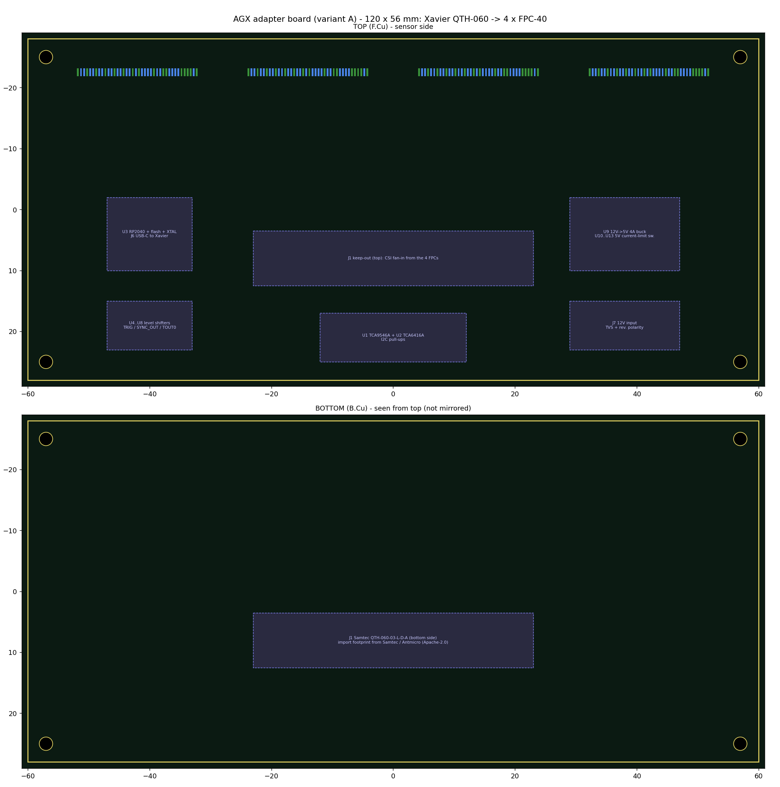

# 3. FPC cable and AGX Xavier adapter board

## 3.1 FPC cable (one per stereo board)

| Item | Spec |
|---|---|
| Connectors | Hirose **FH12-40S-0.5SH(55)** (40 pos, 0.5 mm, ZIF) at both ends, or any 0.5 mm 40-pos ZIF with the same pin order |
| Cable | 40-pos, 0.5 mm pitch FPC with a ground layer / shield, **100 Ω differential** on the CSI pairs (custom impedance-controlled FPC preferred; plain FFC only for ≤ 10–15 cm) |
| Length | ≤ 300 mm at 1.2 Gbps/lane. Longer runs → variant B (GMSL2) |
| Contact orientation | Pin n at the stereo board must arrive at pin n on the adapter. With the stereo board connector on the board's back and the adapter connector on its top, check whether your cable needs same-side (Type A) or opposite-side (Type B) contacts. Confirm on the first article with a continuity test |
| Current | 4 × VIN_5V contacts (0.5 A each) for ≤ 0.6 A per board |

Pinout (G-S-S-G for every pair). The machine-readable source is `hardware/tools/fpc_pinout.py`, and `hardware/adapter/fpc_k_pinout.csv` maps every pin to the adapter net per board.

| Pin | Signal | Pin | Signal |
|---|---|---|---|
| 1 | GND | 21 | GND |
| 2 / 3 | CSI D0 + / − | 22 | PWR_EN (1.8 V, high = power sensors) |
| 4 | GND | 23 | STATUS (1.8 V, high = sensors ready) |
| 5 / 6 | CSI D1 + / − | 24 | TOUT0_L |
| 7 | GND | 25 | TOUT0_R |
| 8 / 9 | CSI CLK + / − | 26 | GND |
| 10 | GND | 27 | FPGA_PROGRAMN (open drain) |
| 11 / 12 | CSI D2 + / − | 28 | reserved |
| 13 | GND | 29, 30 | GND |
| 14 / 15 | CSI D3 + / − | 31–34 | VIN_5V |
| 16 | GND | 35–38 | GND |
| 17 / 18 | I2C SCL / SDA (1.8 V) | 39 | reserved |
| 19 | GND | 40 | GND |
| 20 | TRIG (1.8 V, active low) | | |

## 3.2 AGX adapter board

Generated: `hardware/kicad/adapter_board/adapter_board.kicad_pcb` (120 × 56 mm demo). It contains the four FPC sockets with their nets and keep-outs for everything else. CSVs are in `hardware/adapter/`.

### Xavier connector

* Mating part: **Samtec QTH-060-03-L-D-A** on the adapter's bottom side, plugging into the AGX Xavier devkit camera expansion connector. The AGX Orin devkit uses the same connector.
* The pin map below comes from Antmicro's open-hardware *Jetson AGX CSI Adapter* (Apache-2.0), which is proven on both devkits. A ready-made QTH footprint is in that repository.
* Unused pins (32) are left open. They carry other devkit signals; see NVIDIA's *Jetson AGX Xavier Developer Kit Carrier Board Specification* before using any of them.

| Signal | QTH-060 pins |
|---|---|
| CSI0 D0 / D1 / CLK (±) | 1,3 / 13,15 / 7,9 |
| CSI1 D0 / D1 / CLK | 2,4 / 14,16 / 8,10 |
| CSI2 D0 / D1 / CLK | 19,21 / 31,33 / 25,27 |
| CSI3 D0 / D1 / CLK | 20,22 / 32,34 / 26,28 |
| CSI4 D0 / D1 / CLK | 37,39 / 49,51 / 43,45 |
| CSI5 D0 / D1 / CLK | 59,61 / 71,73 / 65,67 |
| CSI6 D0 / D1 / CLK | 38,40 / 50,52 / 44,46 |
| CSI7 D0 / D1 / CLK | 60,62 / 72,74 / 66,68 |
| I2C_GP3 SCL / SDA (Tegra `i2c@3180000`) | 75 / 77 |
| GPIO10 (SYNC_OUT input) | 85 |
| CAM1_RST (TCA6416A reset) | 92 |
| 1V8_CONN / 3V3_CONN | 102 / 108, 110, 118, 120 |
| AVDD_CAM_2V8 (unused) | 81–83 |
| GND | 5,6,11,12,17,18,23,24,29,30,35,36,41,42,47,48,53,54,63,64,69,70,79,80,99,100,115,116, MP |

### FPC k → Xavier

| FPC signal | Board 0 (J2) | Board 1 (J3) | Board 2 (J4) | Board 3 (J5) |
|---|---|---|---|---|
| D0 | CSI0_D0 | CSI2_D0 | CSI4_D0 | CSI6_D0 |
| D1 | CSI0_D1 | CSI2_D1 | CSI4_D1 | CSI6_D1 |
| D2 | CSI1_D0 | CSI3_D0 | CSI5_D0 | CSI7_D0 |
| D3 | CSI1_D1 | CSI3_D1 | CSI5_D1 | CSI7_D1 |
| CLK | CSI0_CLK | CSI2_CLK | CSI4_CLK | CSI6_CLK |

CSI1/3/5/7_CLK are unused in x4 mode; leave them open. Lane polarity swaps can be fixed in DT (`lane_polarity`) if routing requires.

### Support circuits (`hardware/adapter/adapter_netlist.csv`)

| Block | Part | Notes |
|---|---|---|
| I²C mux | TCA9546A @0x70, VCC 1V8_CONN | channel k → FPC k, 2.2 kΩ pull-ups per channel |
| Board control | TCA6416A @0x20 (VCCI = VCCP = 1.8 V) | P0[3:0] PWR_EN, P0[7:4] VIN_EN, P1[3:0] STATUS, P1[7:4] FPGA_PROGRAMN. RESET# ← CAM1_RST |
| Sync | RP2040 + W25Q16 + 12 MHz + USB-C to Xavier | GP2–5 TRIG0–3, GP6 SYNC_OUT, GP8–15 TOUT0 monitor |
| Level shift | SN74AXC4T774 / SN74AXC1T45 | 3.3 V ↔ 1.8 V for TRIG, SYNC_OUT → GPIO10, TOUT0 |
| 5 V | 12 V → 5 V / 4 A buck + 4 × current-limited switches (~0.8 A) | EN from TCA6416A (1.8 V): choose a switch whose EN threshold accepts 1.8 V (VERIFY) |
| Power in | 12 V barrel/terminal, TVS, reverse-polarity FET | Do not draw camera power from the Xavier connector |

### Layout rules for the adapter

* CSI: 100 Ω differential from each FPC socket to the QTH pins. Intra-pair skew < 0.15 mm; lanes within a port matched to ±0.5 mm, including the FPC length difference if the cables differ. Solid GND reference; one via transition per pair with an adjacent GND via.
* The four TRIG nets should be equal length (sync skew budget). Series-terminate them with 33 Ω at the shifter.
* Keep the 12 V → 5 V buck and its switch node away from the QTH connector and CSI routing.
